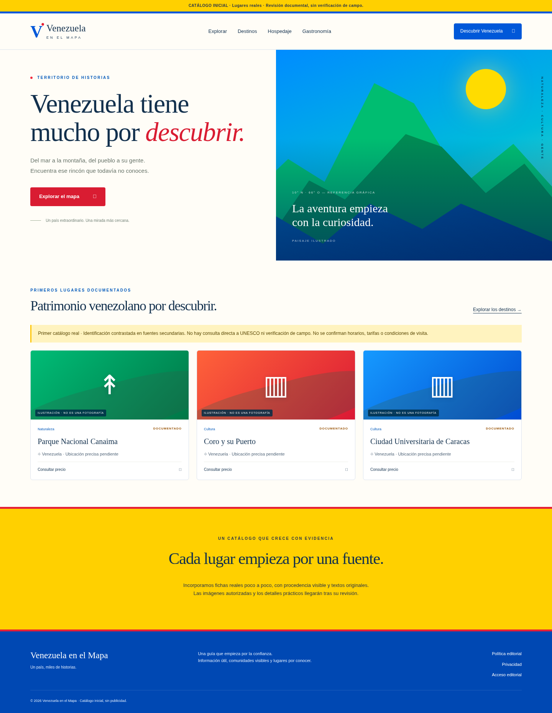

# Venezuela en el Mapa

Proyecto con **dos modalidades claramente diferenciadas**: un catálogo documental estático para GitHub Pages y una aplicación Next.js/PostgreSQL de administración y exploración. El catálogo tiene 37 entradas documentales con fuentes identificadas, pero todavía no constituye un inventario real de establecimientos operativos, reservas ni información de campo actualizada. La aplicación conserva cuatro registros sintéticos DEMO claramente etiquetados y permite importar las 37 fichas documentales a PostgreSQL.

La versión de lanzamiento prepara **fichas con direcciones permanentes, páginas regionales, búsqueda, sitemap, etiquetas sociales, caché PWA y formularios públicos de propuestas/correcciones mediante GitHub Issues**. El backend sigue requiriendo alojamiento Node/PostGIS y una validación operacional específica. No se han contratado servicios.

## Catálogo público inicial

La vista de GitHub Pages contiene **37 lugares documentados**: tres sitios inscritos en Patrimonio Mundial UNESCO, seis localidades y 28 atractivos adicionales investigados con fuentes institucionales, académicas, de conservación y documentación geográfica. Los nuevos registros incluyen parques nacionales, monumentos naturales, espacios urbanos, un pueblo y lugares históricos. **Hacienda Chuao y el centro histórico de La Guaira están únicamente en la Lista Indicativa UNESCO**, no están inscritos como Patrimonio Mundial. El catálogo tiene 20 fotografías reales con autoría y licencias documentadas, además de seis mapas esquemáticos identificados como cartografía.

Los datos están en [content/places.json](content/places.json), la procedencia general en [content/RESEARCH.md](content/RESEARCH.md) el [registro con las primeras 20 fuentes](content/RESEARCH-2026-11-06.md) y la [ampliación a ocho territorios adicionales](content/RESEARCH-COBERTURA-2026-11-06.md). Las fotografías con licencias auditadas se indican y acreditan en cada ficha; las imágenes de otros destinos y los hospedajes contrastados siguen pendientes: los candidatos sin evidencia suficiente no se publican como negocios reales.

Regenerar mapas con `npm run build:maps` y luego generar Pages con `npm run build:pages`. El generador crea fichas permanentes bajo `docs/lugares/`, un índice de estados en `docs/estados/`, páginas regionales con protagonista visual y secciones separadas para atractivos y localidades, `docs/sitemap.xml`, manifiesto y caché. `npm run test:pages` comprueba la vista de catálogo en móvil/escritorio; `tests/site-routes.test.ts` comprueba las páginas estáticas y fuentes. Las capturas de portada y móvil muestran el directorio actual. La aplicación Next/PostgreSQL mantiene aparte sus datos de demostración; no se confunden con este catálogo.

## Vista de la demo

Paleta viva inspirada en la guacamaya: azul intenso, amarillo brillante, rojo y verde tropical.



[Ver captura móvil](docs/screenshots/movil.png) · [Estado y límites de la demo](docs/demo-status.md)

## Inicio rápido

Requisitos: Node.js 24, npm y Docker con Compose. Desde este checkout:

```sh
bash scripts/setup-demo.sh
npm run build
npm run start
```

El servidor escucha en el puerto 3000. La portada, `/explorar`, `/lugares/[id]`, `/admin`, `/politica-editorial` y `/privacidad` funcionan. Las credenciales aleatorias del editor local se guardan en `.data/ACCESO.md`, ignorado por Git. No hay contraseña predeterminada. No compartir ese archivo ni `.env`.

La configuración existente se conserva. La importación demo es explícita, repetible y se niega a ejecutarse si existen fichas reales. No usarla en producción. Para otro entorno, usar `.env.example`, migración y `admin:create` sin importación demo. En `admin:create`, proporcionar `ADMIN_EMAIL` y `ADMIN_PASSWORD` de al menos 12 caracteres mediante un mecanismo seguro de variables de proceso; no escribir contraseñas en comandos guardados.

## Importación documental al servidor

Tras configurar PostgreSQL/PostGIS y ejecutar `npm run db:migrate`, usar `npm run catalog:import` para cargar los registros con evidencia de `content/places.json`. El importador es idempotente y sincroniza las fichas versionadas sin modificar otras fichas creadas en el panel. Las fichas importadas siguen administradas desde el catálogo versionado, no desde el formulario web; se distingue su alcance documental de la comprobación en terreno.

Para detalles de migración y sincronización ver [Catálogo unificado](docs/CATALOGO-UNIFICADO.md). La instalación local de demostración ejecuta esta importación tras crear sus cuatro ejemplos sintéticos.

## Sitio estático y navegación real

[Catálogo de GitHub Pages](https://medinacaj.github.io/descubriendovenezuela/) · [Sitemap](https://medinacaj.github.io/descubriendovenezuela/sitemap.xml) · [Proponer o corregir](https://medinacaj.github.io/descubriendovenezuela/contribuir/).

La disponibilidad pública de esas URL debe verificarse desde el navegador o el estado de despliegue de Pages. GitHub Pages **no ejecuta** el panel de administración ni PostGIS. El catálogo estático contiene páginas indexables y rutas normales adicionales a la vista interactiva original.

## Despliegue con base de datos

[Guía Docker de despliegue](deploy/README.md): imagen sin credenciales locales, PostgreSQL/PostGIS persistente, migración y comprobación de salud. Aún requiere elegir y conectar un alojamiento para obtener una URL pública.

## Desarrollo y pruebas

```sh
npm run dev
# En otra terminal, preparar base de pruebas exclusiva:
npx tsx scripts/prepare-tests.ts
npm test
npm run typecheck
npm run build
# Servidor activo en puerto 3000; requiere /usr/bin/chromium:
npm run test:e2e
```

Las pruebas de integración borran **únicamente** `venezuela_test`. Las pruebas de navegador crean fichas sintéticas temporales y luego las retiran; sus registros de auditoría se conservan. Utilizan el acceso local de `.data/demo-access.json`. No ejecutar E2E en producción.

## Qué incluye

- Búsqueda textual, categoría y jerarquía territorial con paginación; filtros compartibles en URL.
- Mapa MapLibre interactivo con cartografía local de dominio público Natural Earth; sin costos ni solicitudes de mosaicos externos. Límites generalizados y no oficiales; no usar para navegación ni delimitación territorial. Sin marcadores hasta contar con ubicaciones autorizadas.
- Fichas públicas; borradores ocultos; tarifas opcionales con moneda, unidad, fuente y fecha de caducidad; coordenadas sensibles ocultas.
- Login editorial, sesiones en PostgreSQL, crear/editar/publicar/retirar y auditoría transaccional.
- Campos opcionales para direcciones, horarios, web, teléfono y WhatsApp: la proyección pública los oculta sin autorización registrada.
- Fuente HTTPS, fecha y estado verificado obligatorios para publicar. Etiqueta de demo independiente.
- Estado vacío distinto de fallo del catálogo; diseño responsive y navegación por teclado.

## Límites deliberados de esta demo

Aún no hay catálogo administrativo oficial, región piloto con verificación de campo, fichas de negocios contrastados, carga de imágenes para el backend, precios editables, roles múltiples, formularios ciudadanos privados, creadores, anuncios, rutas, IA ni favoritos. En Pages hay caché PWA limitada y aportes vía Issues, no registro automático de negocios. La prueba del flujo con datos sintéticos no acredita verificación de campo. Las políticas públicas describen solo esta demo. No publicar este servidor como producto terminado.

El limitador de login es por cuenta para la demo local; para acceso público se requiere identidad de cliente desde proxy confiable y límites distribuidos. Antes de producción: revisión de seguridad, responsable legal y canal de derechos, operación de imágenes con licencia, recuperación externa, HTTPS, secretos por entorno y catálogo real. No hay pagos ni reservas.

## Documentación

- [Arquitectura](docs/architecture.md) y [plan](docs/superpowers/plans/2026-11-04-mvp-foundation.md)
- [Operación, respaldos y costos](docs/operations.md)
- [API](docs/api.md), [política editorial](docs/editorial-policy.md) y [estado de ejecución](docs/progress.md)
- [Procedencia cartográfica](public/maps/README.md)

## Fotografías reales con derechos documentados

El manifiesto [content/licensed-photographs.json](content/licensed-photographs.json) identifica 12 fotografías de lugares concretos, autor, archivo de Wikimedia Commons y licencia exacta. Los originales pueden consultarse en cada fuente. Se importan mediante `node scripts/import-licensed-photos.mjs` en un entorno conectado a Internet, se convierten localmente a WebP para optimizar la carga y se conservan en `docs/media`. Las fichas incluyen atribución, licencia y aclaración de la conversión técnica. La fotografía ilustra el lugar en la fecha de la toma; no confirma condiciones actuales de visita.

## Navegación editorial por estado

La navegación pública ofrece una jerarquía coherente: **Inicio → Estados y Distrito Capital → Ficha regional → Lugar**. La portada muestra ocho territorios con enlaces a sus fichas y seis atractivos documentados con fotografías reales. El índice `/estados/` permite localizar los 16 territorios actualmente documentados, con búsqueda sin acentos. En las páginas regionales, un sitio real ocupa el primer plano y los demás atractivos se separan de las localidades. No hay posiciones patrocinadas; la selección del lugar principal sigue un criterio editorial explícito en `scripts/region-pages.mjs`. Los estados con solo localidades muestran ese límite sin inventar atractivos. Las fotos tienen autor y licencia visibles; cuando faltan, se usa cartografía identificada o un marcador neutro.

## Fichas de destinos y búsqueda inmediata

Las fichas individuales muestran una fotografía real (o un mapa identificado) en formato editorial grande, con atribución y licencia junto a la imagen. Distinguen la descripción de la verificación documental, los datos del estado y lo **no verificado** (accesos, permisos, horarios, servicios y tarifas). Nunca se deduce que el lugar esté abierto por tener una fotografía. En el explorador estático, los resultados se filtran en tiempo real al escribir, sin recargas de página. La caché de GitHub Pages precarga estilos y páginas esenciales; el modo sin red no sustituye archivos CSS o imágenes fallidos con HTML de portada.

## Cobertura territorial ampliada y piloto comercial

El catálogo tiene al menos una ficha asignada a cada uno de los 23 estados y Distrito Capital; no es cobertura exhaustiva ni garantiza que todas las atracciones de cada territorio estén presentes. Las ocho nuevas fichas identifican Isla de Plata (Anzoátegui), Tapo-Caparo (Barinas), San Esteban (Carabobo), Tirgua (Cojedes), Reserva de Biosfera Delta del Orinoco (Delta Amacuro), Yacambú (Lara), El Guache (Portuguesa) y Relámpago del Catatumbo (Zulia). **Delta del Orinoco es una Reserva de Biosfera UNESCO-MAB, no un sitio del Patrimonio Mundial UNESCO.**

Las 20 fotografías se atribuyen individualmente en [content/PHOTO-CREDITS.md](content/PHOTO-CREDITS.md). Las cinco fotografías añadidas se documentan en el manifiesto de importación y son de años diversos; no confirman accesos ni servicios en 2026. Se mantiene un [piloto de investigación comercial](content/PILOTO-COMERCIAL-PENDIENTE-2026-11-06.md) para posadas en Tucacas sin anunciar como verificados a establecimientos que todavía no cuentan con documentación de licencia vigente y autorización editorial para usar sus contactos o imágenes.
